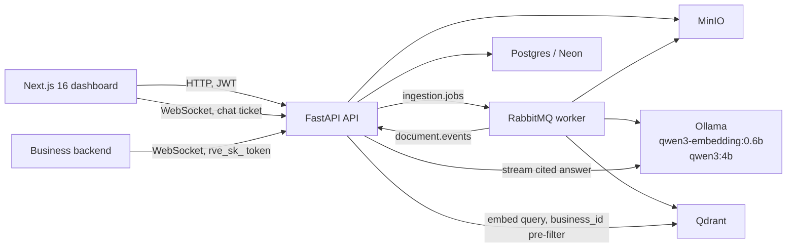

# RAG Vector Engine

A multi-tenant RAG platform that lets a business upload its documents and get streamed, source-cited answers — isolated from every other tenant, and callable from the business's own backend.

This repository is the submission umbrella. The implementation lives in two submodules:

- [`backend`](https://github.com/cy-r0x/rag-vector-engine) — FastAPI API + RabbitMQ ingestion worker
- [`frontend`](https://github.com/cy-r0x/rag-vector-engine-frontend) — Next.js 16 dashboard

## Architecture

A company registers, uploads PDF, Word, Excel, CSV, or text files, and the platform turns those files into Markdown, chunks them, and indexes tenant-isolated vectors. Questions are answered only from that company's corpus: the chat WebSocket embeds the query, pre-filters Qdrant by `business_id`, and streams a grounded reply from a local LLM with numbered source excerpts. If nothing is similar enough, it says so and does not call the model.

Ingestion is asynchronous. The API stores the source object, writes a queued row, and publishes one RabbitMQ job per file; a worker extracts, chunks, embeds, and upserts, then reports `INDEXED` or `FAILED`. For product integrations, each business can issue a rotatable socket token (`rve_sk_…`, shown once, stored as SHA-256) and connect its own backend to the same chat endpoint. Tenant IDs come from verified tokens, never from request bodies.

**Stack**

- API and worker: FastAPI + a RabbitMQ consumer (`python -m workers.consumer`)
- Metadata: Postgres (Neon in production)
- Objects: MinIO (S3 API) at `{business_id}/{doc_id}/source.<ext>`, `extracted.md`, `chunks.jsonl`
- Vectors: Qdrant collection `document_chunks`, mandatory `business_id` pre-filter (`is_tenant`, per-tenant HNSW)
- Models: Ollama, locally run — `qwen3-embedding:0.6b` (1024-d) and `qwen3:4b` (`think: false`, context 8192)
- Frontend: Next.js 16 / React 19 dashboard (Overview, Documents, Chat, Socket access)
- Chat: WebSocket `/v1/chat/ws/{business_id}` with a 60-second browser ticket, an access token, or a static socket token



## Clone

```bash
git clone --recurse-submodules https://github.com/cy-r0x/rag-vector-engine-suite.git
cd rag-vector-engine-suite
```

If you already cloned without submodules:

```bash
git submodule update --init --recursive
```

Run the backend and frontend from their submodule directories. The backend README covers `docker compose up -d` (MinIO, RabbitMQ, Qdrant), Ollama model pulls, migrations, the API, and the worker. The frontend talks to `API_URL` (default `http://127.0.0.1:8000`) and `CHAT_WS_URL`.

## Links

- Backend: https://github.com/cy-r0x/rag-vector-engine
- Frontend: https://github.com/cy-r0x/rag-vector-engine-frontend

## License

This umbrella repository is licensed under the Apache License 2.0. See [LICENSE](LICENSE).
